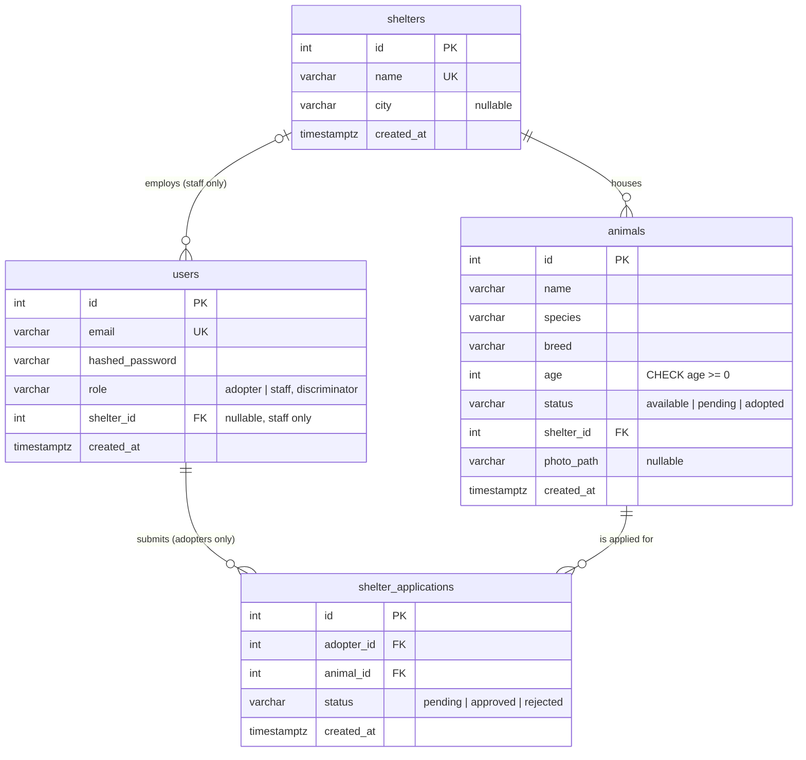

# Database

PostgreSQL 16 in Docker (SQLite for the test suite). The schema is created by
Alembic migrations in `backend/migrations/`, generated from the SQLAlchemy models
in `backend/app/models.py` (column lengths are in the tables below). The class view of the same models is in
[UML_MODELS.md](UML_MODELS.md).

## ER diagram



`users` uses single-table inheritance: `Staff` and `Adopter` share the table and
`role` decides the type. The database cannot tell an adopter's id from a staff
id in `shelter_applications.adopter_id`; the API only lets adopters apply.

## Tables

### shelters

| Column | Type | Null | Notes |
|---|---|---|---|
| id | integer | no | primary key |
| name | varchar(200) | no | unique |
| city | varchar(120) | yes | |
| created_at | timestamptz | no | set by the app (UTC) |

Seeded with three shelters (`python -m app.seed`); there is no API to create them.

### users

| Column | Type | Null | Notes |
|---|---|---|---|
| id | integer | no | primary key |
| email | varchar(255) | no | unique index |
| hashed_password | varchar(255) | no | bcrypt |
| role | varchar(20) | no | CHECK `role IN ('adopter', 'staff')`, index |
| shelter_id | integer | yes | FK -> shelters.id, only meaningful for staff, never set by the API yet |
| created_at | timestamptz | no | |

### animals

| Column | Type | Null | Notes |
|---|---|---|---|
| id | integer | no | primary key |
| name | varchar(120) | no | |
| species | varchar(80) | no | free text |
| breed | varchar(120) | no | |
| age | integer | no | CHECK `age >= 0` |
| status | varchar(9) | no | CHECK `available`, `pending`, `adopted`; default `available` |
| shelter_id | integer | no | FK -> shelters.id, index |
| photo_path | varchar(255) | yes | file name under `UPLOAD_DIR/animals`, served as `/uploads/animals/<file>` |
| created_at | timestamptz | no | |

### shelter_applications

| Column | Type | Null | Notes |
|---|---|---|---|
| id | integer | no | primary key |
| adopter_id | integer | no | FK -> users.id, index |
| animal_id | integer | no | FK -> animals.id, index |
| status | varchar(8) | no | CHECK `pending`, `approved`, `rejected`; default `pending` |
| created_at | timestamptz | no | |

The status rules between applications and animals (apply -> animal `pending`,
approve -> `adopted` and competing applications `rejected`, reject the last open
one -> `available`) are enforced by the API, not by the database; see
[API_CONTRACT.md](API_CONTRACT.md).

Enums are stored as VARCHAR + CHECK rather than PostgreSQL ENUM types, so the same
DDL works on SQLite in the tests.

## Migrations and seed

```bash
cd backend
alembic upgrade head                            # create / update the schema
python -m app.seed --demo                       # shelters + demo data (or without --demo)
alembic revision --autogenerate -m "describe"   # after changing a model, then review the file
alembic check                                   # fails if the models and migrations differ
```

In Docker, `backend/entrypoint.sh` runs the upgrade and the seed on every start
(`SEED_DEMO=1` in `docker-compose.yml` adds the demo data once). CI checks that the
migrations apply on PostgreSQL, match the models and roll back.
